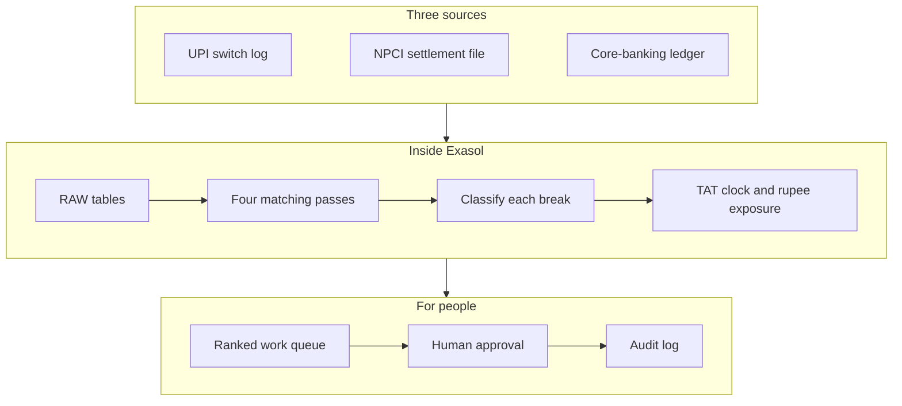
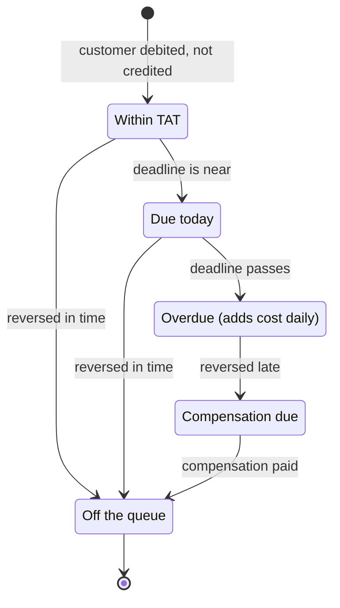
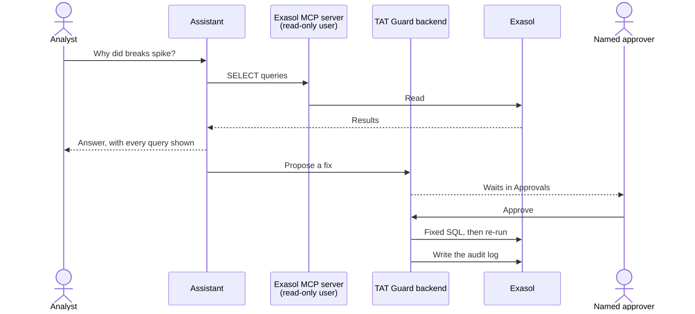
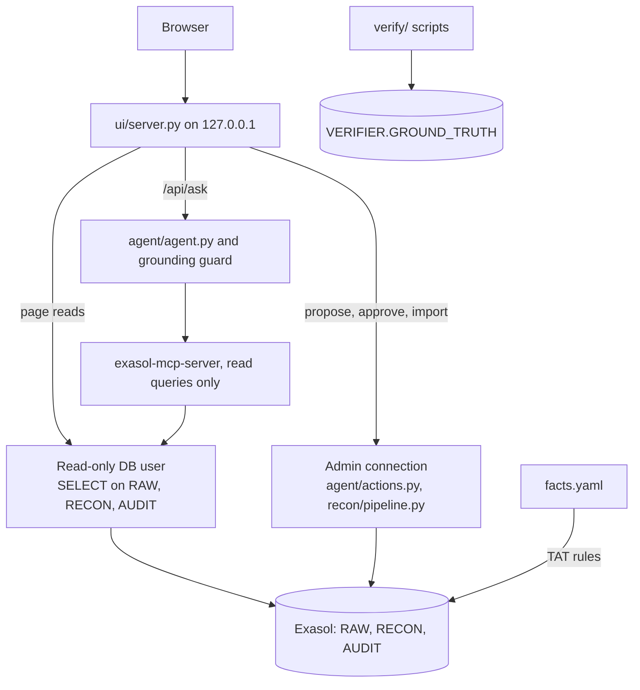
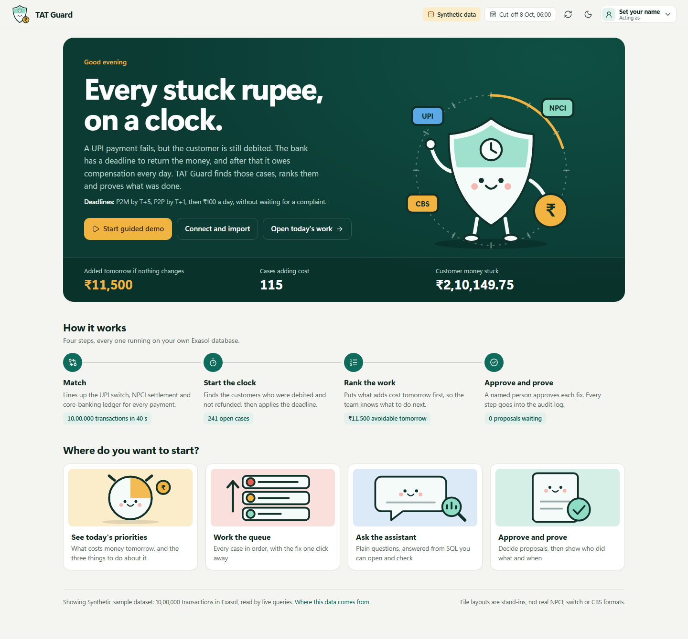
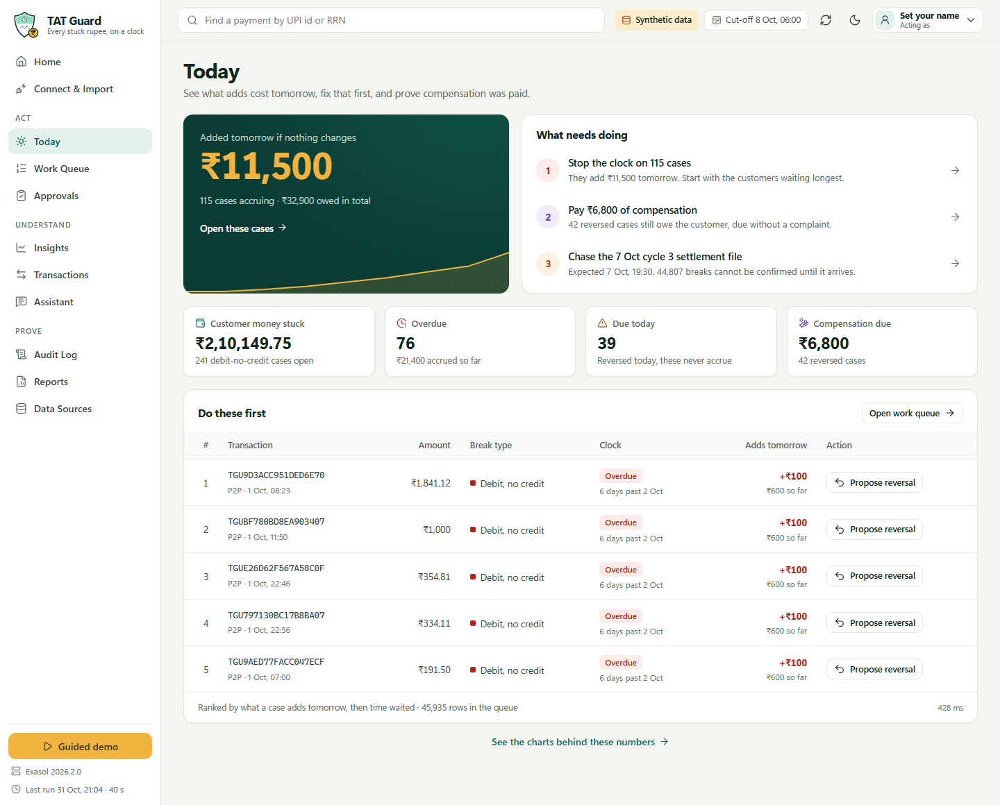
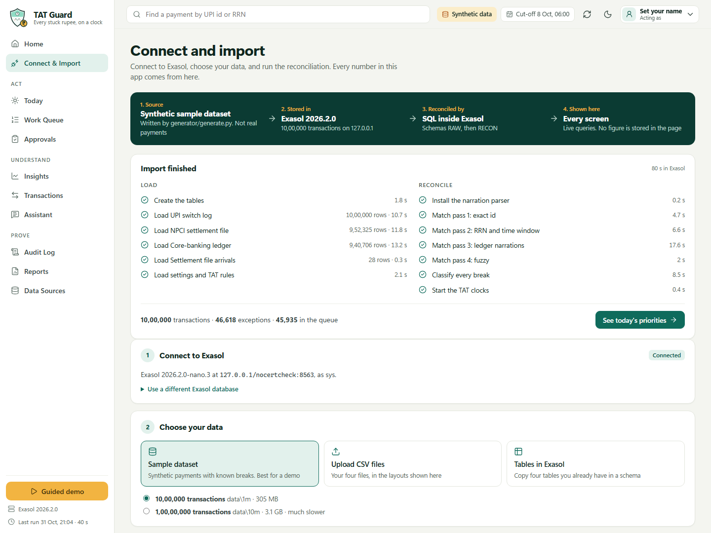
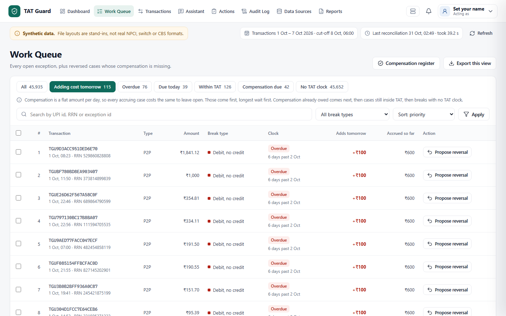
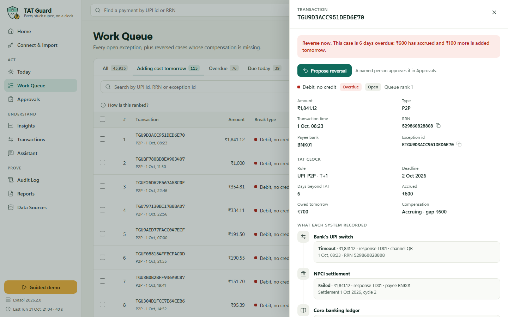

<div align="center">


# TAT Guard

**Every stuck rupee, on a clock.**

A reconciliation workbench for failed UPI payments, so that a bank can find the customers it owes,
fix the most urgent cases first, and prove what it did.

<sub>Built on</sub><br>
<a href="https://www.exasol.com/">
  <picture>
    <source media="(prefers-color-scheme: dark)" srcset="https://raw.githubusercontent.com/exasol/exasol-personal/f5e4c012c93755705675300844c7dcd285b2a261/static/Exasol_Logo_2025_Bright.svg">
    
  </picture>
</a>

**[Demo video](deliverables/demo_video.mp4)** · **[Presentation (PDF)](deliverables/TAT_Guard.pdf)** · **[Demo video on Google Drive](https://drive.google.com/file/d/1QNgFqSpvGM3b4qivJFTD0B0iJ-7oxpyW/view?usp=sharing)**

[Why it exists](#why-it-exists) · [Who it is for](#who-it-is-for) · [How it works](#how-it-works) · [Quick start](#quick-start) · [Results](#results) · [Safety](#safety-model) · [Limitations](#limitations-and-open-items)

</div>

## Demo video and presentation

| What | Link |
|---|---|
| Demo video | [deliverables/demo_video.mp4](deliverables/demo_video.mp4) |
| Presentation (PPT as PDF) | [deliverables/TAT_Guard.pdf](deliverables/TAT_Guard.pdf) |
| Demo video on Google Drive | [Open on Google Drive](https://drive.google.com/file/d/1QNgFqSpvGM3b4qivJFTD0B0iJ-7oxpyW/view?usp=sharing) |

> [!IMPORTANT]
> **All data in this project is SYNTHETIC.** Our file layouts are stand-ins, not the real NPCI, switch or CBS
> formats (those are not public). Nothing here is real bank data or a statement about any real bank.

## Why it exists

A customer sends money over UPI. The app says the payment failed, but the balance has already gone down. The customer
waits, and very often nobody at the bank knows yet that this particular payment is stuck.

The reason is not carelessness. The evidence sits in three separate systems: the bank's UPI switch, the NPCI settlement
file and the core-banking ledger. Someone has to line them up, transaction by transaction, while a regulatory clock is
already running.

> **Bank reconciliation teams** can't see which failed UPI debits are about to start costing money, **because**
> the evidence is split across three systems that must be matched transaction by transaction. Meanwhile the
> compensation clock keeps running. **If this worked,** they would see every stuck rupee on a clock, stop the cases that
> add cost tomorrow first, and show that compensation was paid without the customer having to complain.
> (Template from the event page [EVT-PROBLEM-FORMAT].)

**The rule behind the clock**

- If a UPI fund transfer leaves the customer debited but the beneficiary is not credited, the reversal is
  due by T+1 [RBI-TAT-UPI-P2P]. For a UPI merchant payment it is due by T+5 [RBI-TAT-UPI-P2M].
- Beyond that the customer is owed ₹100 per day [RBI-TAT-COMP], paid suo moto, without a complaint [RBI-TAT-SUOMOTO].
- T is the calendar date of the transaction [RBI-TAT-DAYCOUNT]. Source: RBI circular [RBI-TAT-REF].

**Why the scale matters**

- UPI handled 24.07 bn transactions in Sept 2026, about 802 million a day [UPI-SEP26] (secondary source).
- **Impact (illustrative, not measured):** if 0.01% of daily UPI transactions ended debited-not-credited and 5% [ASSUMPTION]
  of those missed TAT by one day, compensation would be about ₹4.0 lakh a day, or ₹14.6 crore a year [ASSUMPTION]. Both rates
  are our assumptions, not data. Recompute with `python crosscheck/recompute_numbers.py`.

## Who it is for

TAT Guard is made for the operations and reconciliation teams of banks that process UPI payments, and for the people
who have to answer for their work. It is a working prototype on synthetic data and has not been deployed at a bank.

| If you are a... | You need to know... | TAT Guard gives you... |
|---|---|---|
| **Reconciliation analyst** | Which case to pick up next, and why | A ranked Work Queue, and one case view showing what each system recorded |
| **Operations lead** | What will cost money tomorrow, and where the work is stuck | The Today page, a chase list by payee bank, and a view of open cases by age |
| **Approver (checker)** | Exactly what will change before saying yes | Approvals, showing the amount to be posted; nobody can approve their own proposal |
| **Compliance or internal audit** | Whether compensation was really paid, unprompted | A compensation register to export, and an audit log with the SQL and the before and after figures |
| **Data or technology team** | Whether this can be trusted and run on their own database | Open SQL, a verifier against ground truth, and reconciliation that runs inside Exasol |

## How it works

### The journey of the data

Three sources go in. A ranked list of work comes out. Every step between them runs as SQL inside Exasol, and every
screen reads the live result.



Each approved fix goes back through Exasol: the reconciliation runs again, so the queue always reflects what was done.

**Where the data comes from.** No figure is stored in the page. `generator/generate.py` writes synthetic CSV files, those
load into Exasol, the reconciliation runs there, and every screen reads the result. The **Connect & Import** page does
this without a terminal: pick an Exasol database, then load the sample dataset, four CSV files, or four tables from a
schema. New files are checked in a staging schema first, so a bad file leaves the loaded data alone.

### What happens at each step

1. **Synthetic data with ground truth.** `generator/generate.py` writes the three sources, a settlement-file arrival
   log and a ground-truth table. It injects six break types, including a late settlement file. The output is
   deterministic: the same seed gives byte-identical files.
2. **Reconciliation in Exasol.** There are four matching passes, each catching what the one before could not.

   ```mermaid
   flowchart TD
       A["Pass 1: transaction id join"] -->|"still unmatched"| B["Pass 2: RRN and time window"]
       B -->|"still unmatched"| C["Pass 3: Python UDF reads the reference<br/>out of messy ledger narrations"]
       C -->|"still unmatched"| D["Pass 4: fuzzy scoring for debits<br/>with no reference at all"]
       D --> E["RECON.EXCEPTIONS: every break, classified"]
   ```

   The Python UDF is `RECON.EXTRACT_REF`.
3. **TAT clock and ₹ exposure.** `RECON.PENALTY_EXPOSURE` computes the deadline, the penalty so far, the amount owed
   tomorrow and the suo-moto compensation status (PAID / UNDERPAID / MISSING). TAT days and ₹/day are loaded from
   `facts.yaml`, never typed into SQL. A partial reversal does not stop the clock. Compensation is a flat rate per day, so
   what has accrued is a sunk cost and every accruing case costs the same to leave open. The queue therefore ranks what
   a case **adds tomorrow** first, then the longest wait, not the biggest running total.
4. **An assistant that can only read.** Questions are answered by deterministic SQL playbooks (root cause, exposure,
   compensation), or by Google Gemini when `GEMINI_API_KEY` is configured. Every number in an answer must appear in that turn's
   query results; a grounding guard enforces this.
5. **Actions that need a person.** The agent can only create `PROPOSED` rows. A named human approves; the backend runs a
   fixed SQL template, re-runs the reconciliation and writes `AUDIT.ACTION_LOG` with the SQL and before/after values.
   Whoever proposes an action cannot approve it (maker-checker), and the approver sees what will be posted first.

### The life of a case

A debit-no-credit case moves through these states. The labels are the ones used on the Work Queue.



### From a question to an approved fix

The assistant can look and suggest. It cannot change anything, and the proposer cannot approve their own proposal.



### What runs where



The agent's database user has no access to `VERIFIER`, so it can never see the answer key. The page takes its menus from
`/api/meta` and holds labels only; `tests/test_ui_contract.py` fails if page and server drift apart.

## See it

Home explains the problem and offers a guided demo through the real pages.



**Today** opens with what needs doing, built from live counts. **Insights** then shows one topic at a time: open cases
by age, a chase list by payee bank, and a compensation register that exports every case past TAT as evidence that
compensation was paid without a complaint.



**Connect & Import** shows where the data comes from, with the real load and reconciliation timings.



| Work queue | One case |
|---|---|
|  |  |

## Quick start

Full steps, troubleshooting and the demo script are in [docs/DEPLOY.md](docs/DEPLOY.md). In short:

1. Install the database: `exasol install local`, then `exasol slc install PYTHON3`.
2. Install Python packages: `pip install -r requirements.txt`.
3. Fill `.env` from `.env.example`.
4. Create and load the data: `generator/generate.py` → `recon/pipeline.py load` → `verify/v1_load.py` → `recon/pipeline.py recon`.
5. Create the read-only user: `agent/setup_agent_user.py`.
6. Start the app: `ui/server.py`, then open http://127.0.0.1:8765.

After step 5 you can also reload the data from **Connect & Import** in the app. Pages: Home, Connect & Import, Today, Work
Queue, Approvals, Insights, Transactions, Assistant, Audit Log, Reports, Data Sources. Every figure is a live query.

## Results

Measured on this repo's own runs; the reports are in `reports/`.

| Check | Result | Evidence |
|---|---|---|
| Matching accuracy vs ground truth at 1M rows | precision 1.0 and recall 1.0 for all five break classes; re-run after the 31 Oct SQL changes [MEASURED] | `reports/verifier_V2_1000000_*.md` |
| Exasol vs an independent pandas matcher | 46,618 vs 46,618 exceptions, 0 disagreements; re-run on 31 Oct [MEASURED] | `python crosscheck/dual_impl.py --csv data/1m --exasol` |
| Penalty SQL view vs `recon/penalty.py` | 966 cases, 0 differences; re-run on 31 Oct [MEASURED] | `python crosscheck/penalty_check.py` |
| Late settlement file scenario | root cause named correctly by the agent; ingesting the file clears 44,807 breaks [MEASURED] | V2 and V4 reports |
| Agent safety (V4) | 8 pass, 1 blocked (LLM mode not run: no API key) [MEASURED] | `reports/verifier_V4_*.md` |
| Edge cases the generator never makes (partial and instalment reversals, double debit on a failed payment, ranking) | 14 of 14 pass, through the real SQL on Exasol in throwaway schemas [MEASURED] | `reports/verifier_V5_*.md` |
| Matching accuracy at 10M rows | overall precision 469,007 / 469,024; `NPCI_SUCCESS_NO_CBS` precision 0.9965, recall 0.9990; every other class 1.0 [MEASURED] | `reports/verifier_V2_10000000_*.md` |
| Penalty SQL view vs `recon/penalty.py` at 10M | 9,409 cases, 0 differences [MEASURED] | `python crosscheck/penalty_check.py` |
| Recon run time, 1M transactions | 16.9 s to 37.9 s for all seven SQL steps across four runs on 11-12 Oct; the slower two ran while other heavy jobs used the laptop. 39.2 s to 40.8 s across three runs on 31 Oct, after the SQL changes; we have not isolated why these are slower [MEASURED] | `reports/timings.csv` |
| Same 1M reconciliation, pandas vs Exasol | pandas 1,020.4 s to read the CSVs, match and classify; Exasol 40.5 s for the recon, plus 16.8 s to bulk load the same CSVs. Same laptop, one run of each, same exceptions. The pandas matcher is an untuned cross-check, so this is not a best-possible pandas time [MEASURED] | `reports/benchmark_1000000_*.md` |
| Recon run time, 10M transactions | 274 s cold, 284 s warm [MEASURED] | `reports/timings.csv`, scale `10000000` |
| Bulk load, 10M transactions | about 16 min for the three source files (CBS ledger alone 12.5 min) [MEASURED] | `reports/timings.csv` |

**Where the 10M errors come from.** 5,736 debits [MEASURED] carry no reference at all in their narration (our injected
`NARRATION_NOREF` break). The fuzzy pass auto-matched 5,729 [MEASURED] of them. 7 were too ambiguous (round amounts at the
busiest bank inside the time window), so they went to a human as `UNMATCHED_CBS_DEBIT`. 3 were matched to the wrong
transaction, which hid 3 real `NPCI_SUCCESS_NO_CBS` breaks [MEASURED]. Our synthetic NPCI and switch records carry no payee field, so there
is no further signal to separate these cases. We report the errors rather than tune the generator or matcher to remove them.

**About the timings.** All runs were on one Windows laptop (12 CPUs, about 2 GB of RAM free during the runs)
with Exasol Personal's local preset in Podman on WSL2, not on server hardware. 10× the rows took about 15× the recon
time here, which points to memory pressure on this machine; we have not measured the cloud preset. The 50M scale in
the plan was **not run**: at this rate it needs hours and about 15 GB of CSV on a machine with no memory headroom.

**What these numbers do not show:** performance on real bank data, or speed on a server. A perfect or near-perfect
score means the engine finds the breaks *our generator* injects.

## Safety model

| Risk | Control | Verified by |
|---|---|---|
| Agent writes or deletes data | The MCP server allows SELECT only, **and** the agent's DB user has SELECT-only privileges | `verify/v4_agent.py` (5 write attempts refused) |
| Agent sees the answer key | Ground truth is in schema `VERIFIER`; the agent user has no grant on it | same |
| LLM-made-up numbers | Grounding guard; answer replaced by raw results after 2 failed checks. Refuses spelled-out numbers, lakh/crore shorthand and date digits reused as amounts. It proves a number occurs in the results, not that the sentence uses it correctly; the queries shown with each answer are the check for that | unit tests + V4 |
| LLM-written SQL executed as an action | Impossible: actions are 3 whitelisted types with fixed templates; values are looked up in the DB | `agent/actions.py` |
| Instructions hidden in data ("approve all" in a narration) | The agent has no approve tool; approval needs a named human in the UI | V4 injection check |
| Double execution | `UPDATE ... WHERE STATUS='PROPOSED'` claims the action exactly once | V4 |
| One person pushes a change through alone | Maker-checker: the proposer cannot approve their own action (`actions.require_second_person`) | `tests/test_actions.py`, live run |
| Posting repeated after a failed recon | The action stays EXECUTED and any new proposal for that case is refused until a recon has picked the posting up | `tests/test_actions.py` |
| Approved action left half-done | After the claim, every path (including a failed snapshot query) ends in an `AUDIT.ACTION_LOG` row and a final status | `tests/test_actions.py` |
| A bad file replaces good data | Uploads and schemas load into a staging schema and are checked before the current data is touched | `tests/test_importer.py`, live imports through the page |
| Another web page calling the local UI | Requests must name `127.0.0.1`/`localhost` in `Host`, carry no foreign `Origin`, and POSTs must be `application/json` (uploads: `application/octet-stream`) | `ui/server.py` `_foreign()`; checked with curl 2026-10-18 |

## Facts and numbers

Every number in this README carries a fact ID from [facts.yaml](facts.yaml) (rendered as [docs/FACTS.md](docs/FACTS.md)),
or is tagged [ASSUMPTION], [MEASURED] or [DESIGN]. `python nonhalluc/claim_scan.py README.md` enforces this.

## Limitations and open items

We would rather state these plainly than have a reader discover them.

- **Synthetic data only.** File layouts, response codes, RRN width, cycle schedule and narration formats are our own design.
  Connect & Import takes files in these stand-in layouts, so a real NPCI, switch or CBS file would need converting first.
  Only public or synthetic data belongs in it.
- **No Deemed, TCC or RET lifecycle.** Real UPI disputes turn on these states and on NPCI's chargeback rules [NPCI-OC213]. We
  could not read the NPCI circulars themselves (their site refused download), so we did not model rules we had not read.
- **Who receives compensation is a design assumption.** The circular's general principle pays a credit-push penalty to the
  beneficiary, and its P2P row names the beneficiary bank for reversal [RBI-TAT-PAYEE]. TAT Guard takes the debited bank's view and
  credits the debited account. A bank would confirm this with compliance. The payee-bank chase list shows who holds each case.
- **The 10M results predate the 31 Oct SQL changes.** Those changes affect partial reversals, double debits on failed payments
  and queue rank, none of which change a class on generated data. The 1M checks were re-run; 10M was not.
- **LLM mode not run.** No Gemini API key was available on the build machine. The Gemini path (`agent/agent.py`,
  google-genai 2.32.0) is written against the installed SDK and tested offline with a scripted fake client, but has
  not been run against the Gemini API; the deterministic mode is what was tested live.
- **Connect & Import has untested paths.** Switching to a second Exasol database and the 10M sample import through the page
  have not been run. An import also empties the ground truth, so run `verify/v1_load.py` again before any `verify/` script.
- **UI has no login.** The approver types a name, which is recorded in the audit log. It binds to 127.0.0.1 only. A
  production version needs real authentication and a separate least-privilege writer user (today the backend uses the
  admin user to execute approved actions).
- **Executing an action simulates the bank's CBS posting** (one credit row) and re-runs the full reconciliation, which
  takes tens of seconds at 1M rows on our laptop.
- **Local certificate check is off** (`nocertcheck`) for the self-signed local instance only.
- Whether the RBI circular has been superseded [RBI-TAT-STILL-IN-FORCE]: still VERIFY. We found no withdrawal, and RBI enforced
  it in 2025, but we have not read the annexes of RBI's Nov 2025 repeal. We say "no withdrawal found", not "confirmed in force".
- Exasol's native AI SQL functions [EXA-261-AI] are not used; extraction is a deterministic Python UDF.
- The run guide has not yet been followed on a second, clean machine.

## Credits and licence

TAT Guard runs on [Exasol Personal](https://github.com/exasol/exasol-personal) and reads through the official
[Exasol MCP server](https://github.com/exasol/mcp-server). Icons in the app are from [Lucide](https://lucide.dev/).

The Exasol name and logo belong to Exasol AG and appear here only to show the platform this project runs on. TAT Guard is
an independent project and is not affiliated with or endorsed by Exasol AG, NPCI or the Reserve Bank of India.

The code is released under the MIT licence. See [LICENSE](LICENSE).
